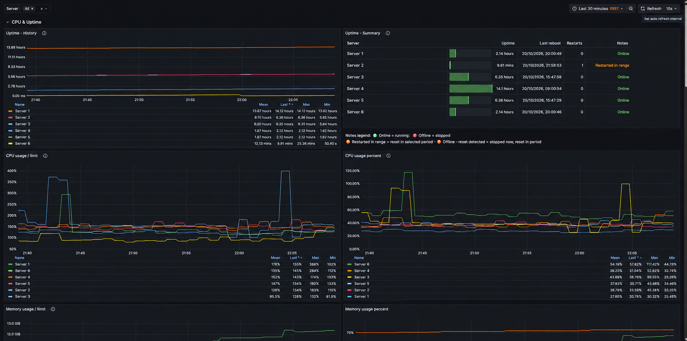
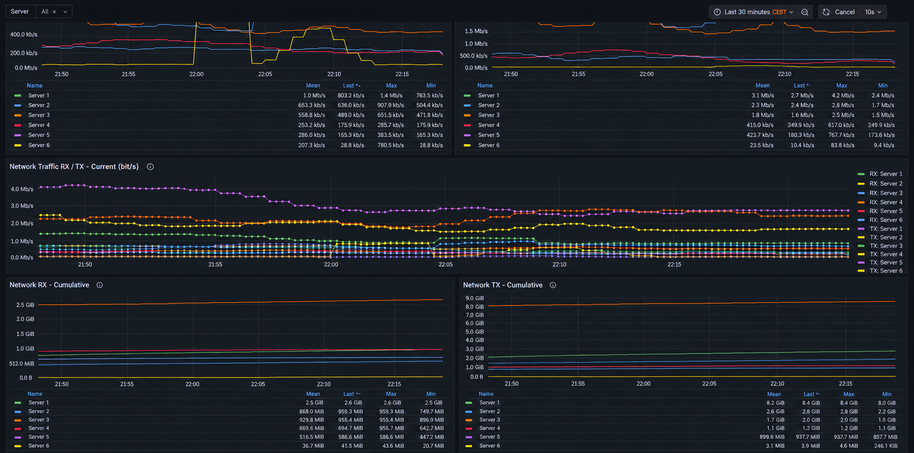
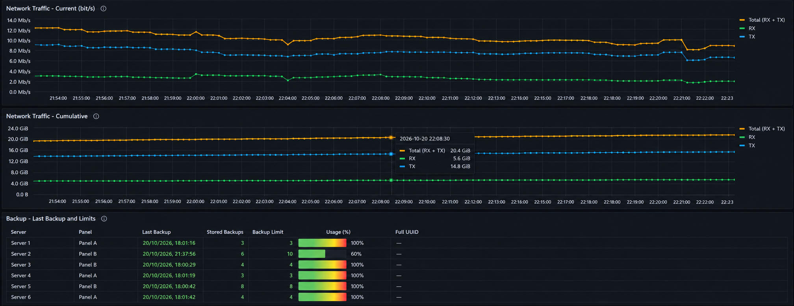

# Pterodactyl Exporter

### Please use the Discussion for Support rather than the Issues.

A python script that exports performance metrics from Pterodactyl Panel 1.x via the Client API, converts the data to the correct format and provides a prometheus target.

This can be used for time series monitoring of Pterodactyl game servers and visualization with Grafana.

Feel free to try this script and submit an issue if needed.

## Features added in this fork

This fork is based on [LOENS2/pterodactyl_exporter](https://github.com/LOENS2/pterodactyl_exporter).
Scalbox added full-UUID server inclusion/exclusion filters and **new Prometheus
metrics** ([see the complete list](#metrics-added-by-scalbox-in-this-fork)).
This fork also introduces persistent RX/TX network accounting, customized
English/Italian Grafana dashboards, a custom **Grafana Uptime & Restart Monitor
panel plugin** ([features, installation and manual build](#grafana-uptime-and-restart-panel-plugin)),
and the Docker/GHCR automated release workflow. The existing upstream metric
names and labels are preserved.

The exporter uses the Pterodactyl Client API. It does **not** require an exporter or
other monitoring software to be installed on Pterodactyl nodes.

# How to install

**Latest stable release:** [View on GitHub](https://github.com/scalbox/pterodactyl_exporter/releases/latest).

## What you need:

 * Linux server (should run on Windows as well, but is only tested in a linux environment)
 * Prometheus
 * Python (3.10)
 * Pterodactyl client API key 
   * Service account with read only is recommended
   * You only need to set `Backup->Read` as permission for the account to the server you want to monitor.

## Run as Pterodactyl Server

 - Download the Egg JSON from `egg/egg-pterodactyl-exporter.json` or the releases
 - Import the Egg into the Nest of your choice
 - Create the server from the egg and fill in the required config values
 - Run the server

## Run as service

#### Installed as user "prometheus":

 - To install with pipx:
```
pipx install "git+https://github.com/scalbox/pterodactyl_exporter.git@1.0.12"
```

 - To install with pip _(not recommended, could break system dependencies)_:
```
pip install "git+https://github.com/scalbox/pterodactyl_exporter.git@1.0.12"
```
 - Create directory `pterodactyl_exporter`.
 
 - Create the config file `config.yml` in that directory (set the values as needed, it's recommended to use https):
 
 ```yml
host: panel.example.com
host_port: # This is the port of the panel (optional)
port: 9531 # Standard exporter listening port
listen_address: 127.0.0.1 # Bind locally when Prometheus runs on this host
api_key: APIKEY_APIKEYAPIKEYAPIKEY
https: true
ignore_ssl: false
server_list_type: owner
query_interval: 10 # Interval in seconds between each query to the Pterodactyl panel (default: 10)
include_servers: [] # Optional full-UUID allowlist (empty = all accessible servers)
exclude_servers: [] # Optional full-UUID blocklist
# traffic_state_file: data/network_traffic.json # Persistent RX+TX state (relative to config.yml)
 ```

 The `listen_address` setting controls which interface serves `/metrics` (`127.0.0.1` for local-only access, `0.0.0.0` for all interfaces). If omitted, it defaults to `0.0.0.0`. It is separate from `host` and `host_port`, which refer to the Pterodactyl panel. Restart the exporter after changing the setting.

 - Create systemd service `/etc/systemd/system/pterodactyl_exporter.service`:
```
[Unit]
Description=Prometheus Server
After=network-online.target

[Service]
User=prometheus
Restart=on-failure
ExecStart=pterodactyl_exporter \
--config-file=/home/prometheus/pterodactyl_exporter/config.yml

[Install]
WantedBy=multi-user.target
```

 - Enable and start the service.
 
 - Add a job configuration:
 
 ```yml
 - job_name: 'pterodactyl_exporter'
    static_configs:
      - targets: ['localhost:9531']

 ```

 - To use the dashboards bundled with this fork, see [Grafana dashboards](#grafana-dashboards). The original upstream Grafana dashboard is also available under ID `16575`.
 
 #### Servers can be selected by changing API permissions or with the UUID filters documented below.

## Server inclusion and exclusion

**Added by Scalbox in this fork.** The `include_servers` and `exclude_servers`
configuration options are not available in the original LOENS2 exporter.

Set `include_servers` and/or `exclude_servers` in `config.yml` to control which
servers are monitored. These lists contain **full server UUIDs**, not the short
8-character identifiers displayed in some Pterodactyl views.

```yaml
include_servers:
  - "11111111-1111-4111-8111-111111111111" # Production server
  - "22222222-2222-4222-8222-222222222222" # Testing server

exclude_servers:
  - "22222222-2222-4222-8222-222222222222" # Do not monitor testing
```

- When `include_servers` is empty or omitted, all servers accessible to the API key
  are eligible for monitoring.
- When `include_servers` contains UUIDs, only matching servers are eligible.
- UUIDs in `exclude_servers` are always skipped, even if also included.
- Matching is case-insensitive, and surrounding whitespace is ignored.
- Filtering happens **before** individual server resource and backup API requests.
  Excluded servers therefore do not incur those per-server requests.
- Restart the exporter after changing its configuration. Previously collected
  Prometheus samples remain until the configured retention period expires or
  the data is deliberately removed from Prometheus.

For no filtering, use `include_servers: []` and `exclude_servers: []`.
The API key must still have the appropriate Client API permissions.

## Metrics

The exporter exposes **16 Pterodactyl-specific Prometheus metrics**, all of type
`Gauge`. The 12 upstream metrics are listed first, followed by the four metrics
added by Scalbox in this fork. Metrics generally use the `server_name` and `id`
labels (`id` is the short server identifier); the identity metric additionally
includes the complete `uuid` label.

### Original metrics (LOENS2 upstream)

| Metric | Type | Description |
| --- | --- | --- |
| `pterodactyl_server_cpu_absolute` | Gauge | Current CPU usage in percent; values may exceed 100% on multicore servers. |
| `pterodactyl_server_max_cpu_absolute` | Gauge | Configured CPU limit in percent (0 = unlimited). |
| `pterodactyl_server_memory_mebibyte` | Gauge | Currently used RAM in MiB. |
| `pterodactyl_server_max_memory_mebibyte` | Gauge | Configured RAM limit in MiB (0 = unlimited). |
| `pterodactyl_server_disk_mebibyte` | Gauge | Currently used disk space in MiB. |
| `pterodactyl_server_max_disk_mebibyte` | Gauge | Configured disk limit in MiB (0 = unlimited). |
| `pterodactyl_server_max_swap_mebibyte` | Gauge | Configured swap allocation in MiB. |
| `pterodactyl_server_io` | Gauge | Configured disk I/O weight. |
| `pterodactyl_server_network_rx_mebibyte` | Gauge | Total traffic received in MiB since the latest game-server counter reset. |
| `pterodactyl_server_network_tx_mebibyte` | Gauge | Total traffic transmitted in MiB since the latest game-server counter reset. |
| `pterodactyl_server_uptime_milliseconds` | Gauge | Current server uptime in milliseconds. |
| `pterodactyl_server_most_recent_backup_time` | Gauge | Unix timestamp (seconds) of the most recent successful backup; 0 if unavailable. |

### Metrics added by Scalbox in this fork

| Metric | Type | Description |
| --- | --- | --- |
| `pterodactyl_server_backup_count` | Gauge | Number of currently stored server backups. |
| `pterodactyl_server_backup_limit` | Gauge | Maximum number of backup slots configured for the server; `NaN` when unavailable. |
| `pterodactyl_server_identity_info` | Gauge | Constant value `1`, with the full server UUID in the `uuid` label. |
| `pterodactyl_server_network_historical_total_mebibyte` | Gauge | Persistent historical RX + TX total in MiB, maintained across game-server and exporter restarts when the state file is preserved. |

These are the complete **Pterodactyl application metrics** defined by the
exporter. The Prometheus Python client may also expose standard Python runtime
and process metrics, depending on the installed version and platform.

The backup metrics use data returned by the existing server-list and backup-list
requests. Backup counts use the API's pagination total when available; backup
limits come from each server's `feature_limits.backups`. A missing limit is
represented as `NaN`. The existing backup-list request always targets page 1,
independent of the server-list page number.

For example, Prometheus exposes data in this form:

```prometheus
pterodactyl_server_backup_count{server_name="Production",id="11111111"} 5
pterodactyl_server_backup_limit{server_name="Production",id="11111111"} 6
pterodactyl_server_identity_info{server_name="Production",id="11111111",uuid="11111111-1111-4111-8111-111111111111"} 1
pterodactyl_server_network_historical_total_mebibyte{server_name="Production",id="11111111"} 15360
```

The UUID is intentionally provided in a separate information metric, so the
labels of existing metrics (including `server_name` and `id`) do not change.

These changes are built into this fork. Do not run the legacy third-party
patching script against this version; it was only intended for the unmodified
upstream package.

## Grafana dashboards

**Added by Scalbox in this fork.** These customized English and Italian
Grafana dashboards are developed and maintained by Scalbox.

This fork includes two language versions of the **Pterodacty l Server & Network**
Grafana dashboard in the [`dashboards/`](dashboards/) directory:

- [English dashboard](dashboards/Pterodactyl-Server-Network-en.json)
- [Italian dashboard](dashboards/Pterodactyl-Server-Network-it.json)

### Dashboard screenshots

The screenshots below show the dashboard with anonymized server names and UUIDs.
Click an image to view it at full resolution.

**CPU, Uptime, Memory, and Disk**

[](dashboards/screenshots/01-cpu-uptime-memory-disk.png)

**Network RX/TX — Current and Cumulative**

[](dashboards/screenshots/02-network-rx-tx.png)

**Total Network Traffic and Backups**

[](dashboards/screenshots/03-network-traffic-backups.png)

Both exports contain the same panels, Prometheus queries, server selector, and
layout. Only the user-facing labels, descriptions, legends, and backup-table
messages differ by language.

### Grafana uptime and restart panel plugin

**Added by Scalbox in this fork.** The custom **Scalbox Uptime & Restart
Monitor** panel replaces the original `Uptime` bar gauge on the right of
`Uptime - History` / `Uptime - Storico` in **both** dashboards.

#### Why a plugin is necessary

Grafana's standard Time series, State timeline, Bar gauge and Table panels each
provide some of the required features, but a single standard panel cannot
combine this specific two-line-per-server layout with all the interactive
controls, restart markers, resizable name column and internal scrolling.
The custom panel implements this in one view **without installing anything on
the Pterodactyl game servers**. It runs inside Grafana and consumes the
existing Prometheus metric `pterodactyl_server_uptime_milliseconds`.

Features:

- Uptime timeline per server (green = running, red = stopped, grey = missing
  samples), with orange restart markers derived from detected uptime resets.
- **All / Online / Restarted** filters with counts and case-insensitive search
  by full server name or server ID.
- A time selector (1 hour, 6 hours, 24 hours, 7 days or 30 days) **synchronized
  with Grafana's dashboard time range**, so the Prometheus query fetches data
  for the selected interval. Changing it also changes the dashboard's other
  panels, as does Grafana's own time picker.
- Full server names on hover, ellipsis for long names and a draggable separator
  to resize the server-name column.
- Two lines per server: timeline/current uptime, then **Last reboot (complete
  date and time), Restarts and Notes**. The reboot date/time is formatted using
  the **timezone selected in the Grafana dashboard**, including DST.
- Internal **vertical scrolling**, sized to display about six server entries at
  a time with the standard 12-grid-unit panel height.
- English and Italian labels automatically selected by the corresponding
  imported dashboard. You can also change the language in the panel editor.

**Accuracy note:** The exporter currently exposes an uptime gauge, not a
separate authoritative restart-event history. The plugin **estimates** restarts
from uptime counter decreases or transitions from zero to a positive value.
Restarts that occur entirely between two Prometheus samples may be missed.
The last reboot time is estimated from `sample timestamp - measured uptime`.
An uptime of zero is shown as offline, and stale/missing samples as unknown.
Notes are automatically derived status messages; they are not editable.
Past history is limited by your Prometheus retention and scrape interval.

#### Download and install the compiled plugin

The **source code** is in
[`grafana-plugin/src/`](grafana-plugin/src/), and the **ready-built plugin**
is committed in [`grafana-plugin/dist/`](grafana-plugin/dist/).
Every new version tag published through the GitHub Actions release workflow
also builds/tests the plugin and adds the installable asset
`scalbox-uptime-panel-X.Y.Z.zip` to the
[GitHub Releases](https://github.com/scalbox/pterodactyl_exporter/releases)
page alongside the Python packages.

On a standard Linux Grafana installation:

1. Download `scalbox-uptime-panel-X.Y.Z.zip` from a release **created after
   this plugin was added**. Replace `X.Y.Z` with the tag version.
2. Extract it into Grafana's plugin folder (the ZIP already contains a directory
   named `scalbox-uptime-panel`):

   ```bash
   sudo unzip scalbox-uptime-panel-X.Y.Z.zip -d /var/lib/grafana/plugins/
   sudo chown -R grafana:grafana /var/lib/grafana/plugins/scalbox-uptime-panel
   ```

3. **Allow this specific unsigned plugin.** It has not been submitted for
   official Grafana signing. Grafana normally rejects unsigned plugins.
   In `/etc/grafana/grafana.ini`, under `[plugins]`:

   ```ini
   [plugins]
   allow_loading_unsigned_plugins = scalbox-uptime-panel
   ```

   Or, for Grafana running via Docker/Compose, set:

   ```yaml
   environment:
     GF_PLUGINS_ALLOW_LOADING_UNSIGNED_PLUGINS: scalbox-uptime-panel
   ```

   Only enable an unsigned plugin after reviewing/trusting its source.
   An unmodified plugin distributed with this fork uses ID
   `scalbox-uptime-panel`; **do not disable signature verification globally**.

4. Restart Grafana (for example, `sudo systemctl restart grafana-server`)
   and import the [Italian](dashboards/Pterodactyl-Server-Network-it.json) or
   [English](dashboards/Pterodactyl-Server-Network-en.json) dashboard.
   Make sure your Grafana instance is connected to the Prometheus exporter.
   The dashboard shows a missing-plugin message until this plugin is installed
   and Grafana has restarted.

For Grafana in Docker, mount the extracted
`scalbox-uptime-panel/` folder at
`/var/lib/grafana/plugins/scalbox-uptime-panel/` inside the container and
apply the same environment variable. The plugin is frontend-only (no extra
server daemon or Pterodactyl modification).

#### Compile manually from source

Use **Node.js 22 LTS** and npm. From the `grafana-plugin` directory
inside a clone of this repository, on **Windows PowerShell, Linux or macOS**:

```bash
npm ci             # Install exact dependencies from package-lock.json
npm run check      # Tests + TypeScript validation + production build
```

To compile without running tests:

```bash
npm run build
```

The commands are identical in Windows PowerShell. Run them **inside**
`grafana-plugin/`, not at the repository root. A successful build produces
`dist/module.js`, `dist/plugin.json` and `dist/img/logo.svg`.

**What does `scripts/copy-plugin-json.mjs` do?** It is a build helper, not an
additional command to run manually. `npm run build` first validates the
TypeScript code and compiles the Grafana SystemJS module with Rollup, then
automatically runs this script. It copies `src/plugin.json` and the SVG logo
into `dist/`. If the release workflow provides the `PLUGIN_VERSION`
environment variable (for example `1.0.13`), the script also updates
`dist/plugin.json` to that version so it matches the Git tag.
The script is **source/build tooling only** and is not included in the
installable release ZIP.

**Windows / Dropbox troubleshooting:** `npm ci` deliberately removes an
existing `node_modules/` before reinstalling packages. On Windows,
`npm error EBUSY: resource busy or locked, rmdir ...\\node_modules\\...`
means that another process is holding files open. If your checkout is under
Dropbox or OneDrive, pause synchronization, close programs using the folder
(e.g. IDEs and terminals running Node), then retry `npm ci`.
If the folder continues to be locked, build from a local non-synchronized copy.
In **PowerShell**, starting from the original `grafana-plugin` folder:

```powershell
$buildDir = Join-Path $env:LOCALAPPDATA 'Scalbox\grafana-plugin-build'
New-Item -ItemType Directory -Path $buildDir -Force | Out-Null
robocopy . $buildDir /E /XD node_modules
Set-Location $buildDir
npm ci
npm run check
```

The compiled plugin will then be in `$buildDir\dist`. This copies the
current source files, including any local edits, but excludes the locked
`node_modules/` directory. Avoid running npm commands in two terminals at
once. Do not delete or replace `package-lock.json` to work around EBUSY.

**Warnings versus errors:** `npm warn ERESOLVE` and deprecation notices
from transitive Grafana 10.3.1 development dependencies are warnings, not
build failures. If `npm ci` finishes with `added ... packages`, continue
with `npm run check`. `npm audit` can report issues in the development
toolchain even though these packages are not bundled into the compiled
plugin; use `npm audit --omit=dev` to separately inspect production
dependencies. Do **not** run `npm audit fix --force` without reviewing
the proposed dependency and compatibility changes.

The compiled files are generated in `grafana-plugin/dist/`, including
`plugin.json` and the Grafana-compatible `module.js`. To install a build
directly from the repository, copy the **contents** of `dist/` to
`/var/lib/grafana/plugins/scalbox-uptime-panel/`, enable the unsigned plugin
as above and restart Grafana.

The release workflow is in
[`.github/workflows/publish-docker.yml`](.github/workflows/publish-docker.yml):
it runs `npm ci` and `npm run check`, packages the resulting `dist` under
its plugin-ID directory, and uploads the versioned ZIP as a GitHub Release
asset when a stable tag (for example, `1.0.13`) is pushed. The same workflow
continues to publish the original Python and Docker artifacts.

#### Grafana support

The plugin targets Grafana **10.3 or newer** with a Prometheus datasource.
It is intended for self-hosted Grafana installations where administrators can
explicitly permit this unsigned custom plugin; managed Grafana services may
not allow unsigned plugins.

The dashboards include:

- CPU and memory usage, disk usage, current uptime, and historical uptime.
- Per-server network RX and TX charts for both cumulative traffic and current
  throughput in Mbps, including combined RX/TX views and overall totals.
- A persistent, all-time RX + TX total directly below the current cumulative
  network total, independent of Pterodactyl server restart resets.
- A per-server backup table with the latest backup, stored backup count, backup
  limit, usage indicator, panel name, and complete server UUID.

### Persistent network traffic totals

**Added by Scalbox in this fork.** The persistent network counter and its
Grafana history panel extend the original exporter's restart-resetting RX/TX
metrics.

The new historical network panel uses
`pterodactyl_server_network_historical_total_mebibyte`, introduced in the
exporter alongside the updated dashboards. **Update/restart the exporter as
well as importing the JSON**; older exporter versions will leave this panel empty.

Pterodactyl's RX/TX values restart at zero with a game server. The exporter
now tracks positive increments for each server's UUID, detects resets in each
direction and writes the cumulative total to a JSON state file after each
successful collection cycle. The default path is `data/network_traffic.json`
**relative to the directory containing `config.yml`**. You may set the
optional `traffic_state_file` configuration key to an absolute path or a
different relative path. The exporter must have write access to the directory.

**Keep and back up this file.** If it is deleted or stored only in an
ephemeral container layer, the historical total will restart from the currently
reported server counters. The provided Docker Compose file mounts
`../data:/opt/pterodactyl_exporter/config/data`; retain this volume when
updating or recreating the container. Pterodactyl Egg installations should
also retain the `data/` directory alongside their `config.yml`.

The lifetime total begins when the updated exporter first observes a server.
On first observation, it includes the RX/TX amounts reported for that server's
*current boot*; older restarts cannot be backfilled from a live counter.
Traffic transmitted between the last successful exporter poll and an
unobserved reset may also be missed. With the state file preserved, the
reported total does not decrease as observed counters reset. The time range
available in Grafana still depends on Prometheus data retention.

To import either version, open **Grafana > Dashboards > New > Import**, upload
the desired JSON file, select your **Prometheus** data source, and import it.
The exporter must be reachable by Prometheus and provide the additional backup
and identity metrics described above for those columns to contain data.

The **Server** selector filters the displayed metrics in Grafana. To prevent
servers from being queried and exported at all, configure `include_servers`
and/or `exclude_servers` in the exporter instead.

Both JSON files use the same dashboard title and are intended as alternative
language versions. To keep both in one Grafana installation, import them into
different folders or choose distinct dashboard names during import.
 
## Run with Docker (starting with 1.0.9)

**Added by Scalbox in this fork.** The fork's prebuilt multi-platform Docker
images are distributed through GitHub Container Registry (GHCR).

Starting with **1.0.9**, release images are published from this fork to GitHub
Container Registry (GHCR). The Compose file uses the pinned image
`ghcr.io/scalbox/pterodactyl_exporter:1.0.11` and does not use the upstream
`loens2/pterodactyl_exporter` image. The Docker image is published by GitHub Actions after the version tag is pushed
and its multi-platform build completes successfully.

Create the files and edit `config.yml` with your Pterodactyl Client API details:

```bash
mkdir -p pterodactyl_exporter/docker
cd pterodactyl_exporter
curl -fsSL -o config.yml https://raw.githubusercontent.com/scalbox/pterodactyl_exporter/main/config.example.yml
curl -fsSL -o docker/docker-compose.yml https://raw.githubusercontent.com/scalbox/pterodactyl_exporter/main/docker/docker-compose.yml
# Edit config.yml before starting the exporter.
# Compose mounts ../data into the container to keep network traffic totals.
docker compose -f docker/docker-compose.yml pull
docker compose -f docker/docker-compose.yml up -d
```

The Compose file mounts `config.yml` read-only and restarts the exporter unless
it is explicitly stopped. By default, it maps port 9531 on all host interfaces.
**In Docker, keep `listen_address: 0.0.0.0` in `config.yml`**, because the
exporter must accept connections from outside the container's own loopback.
If Prometheus runs on the Docker host, restrict access using the Compose
port mapping `127.0.0.1:9531:9531` instead. This limits the host's published
port; `listen_address: 127.0.0.1` inside the container would prevent the
published Docker port from reaching the exporter.

### Automated Docker and Python releases

**Added by Scalbox in this fork.** The automated release pipeline publishes
Docker images and Python packages for each tagged version.

The [release workflow](.github/workflows/publish-docker.yml) runs whenever a
stable version Git tag such as `1.0.11` is pushed. It:

1. Runs the Python regression tests, builds the wheel (`.whl`) and Python source
   distribution (`.tar.gz`) from the exact tagged commit, and validates both.
2. Builds Docker images for Linux `amd64` and `arm64` and publishes the versioned
   image (`:1.0.11`) and `:latest` to GHCR.
3. **Only after both jobs succeed**, creates a GitHub Release for the tag, with
   the Python distributions attached as downloadable release assets.
4. Uses the **annotated Git tag message** as the GitHub Release description.
5. Updates the version in both `pipx` and `pip` installation commands and the
   Docker Compose image tag on `main` after successful release publication.
   It never replaces a newer installed version with an older one.

GitHub automatically adds two source snapshots (ZIP and TAR.GZ) to every release.
The workflow adds two different Python installation packages:
`pterodactyl_exporter-X.Y.Z-py3-none-any.whl` (wheel) and
`pterodactyl_exporter-X.Y.Z.tar.gz` (source distribution). The Docker image is
published separately under GitHub Packages (GHCR), not as a release asset.

Before creating a tag, use **Actions > Publish Docker and Python release > Run
workflow** on `main` to validate Docker and Python builds. Manual runs do **not**
publish Docker images or create GitHub Releases.

To release a new version, first push the desired commits to `main`, then create
an annotated tag pointing to that commit. For example, in PowerShell:

```powershell
git tag -a 1.0.11
git push origin refs/tags/1.0.11
```

The `git tag -a` command opens your configured editor; write the complete
English release notes in the tag message. A short one-line message also works,
but the automated GitHub Release will then contain only that short message.
Do not move an already published release tag to add workflow changes; publish
the updated workflow on `main` **before** creating the next version tag.

No Docker Hub credentials or personal access tokens are needed: the workflow
uses GitHub's `GITHUB_TOKEN` with `packages: write` for GHCR and
`contents: write` only for the release-publishing job. If a GitHub Release
already exists for the same tag, a rerun leaves it unchanged. The README update
is committed by GitHub Actions only when the installed version actually changes.

New GHCR packages may initially be private. After the first publish, open the
package settings on GitHub and change its visibility to **Public** if users
should be able to run `docker pull` without authentication.

## Run manually

#### Only meant for testing purposes, not recommended for production use!

 - Clone the project:
```
git clone https://github.com/scalbox/pterodactyl_exporter.git
```
 - Change to the cloned directory
```
cd pterodactyl_exporter
```
 - Install dependencies:
```
python -m pip install -e .
```
 - Run with python:
```
python -m pterodactyl_exporter.pterodactyl_exporter --config-file=config.example.yml
```

# Troubleshooting

You can view the output with (Time is UTC):

```
sudo journalctl -u pterodacyl_exporter.service -b --since "2024-12-14 13:45:27"
```

Post any stacktraces as an Issue.

##

With special thanks to @grimsi for helping me with docker.

&copy; LOENS2 2023
